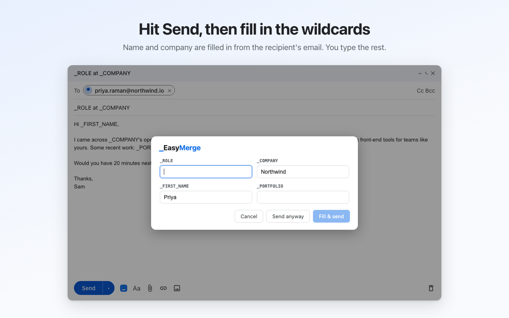
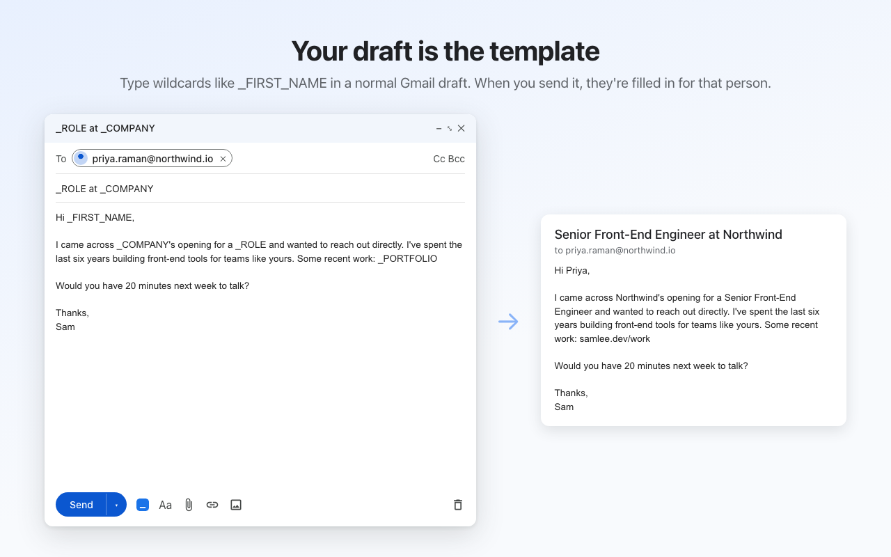
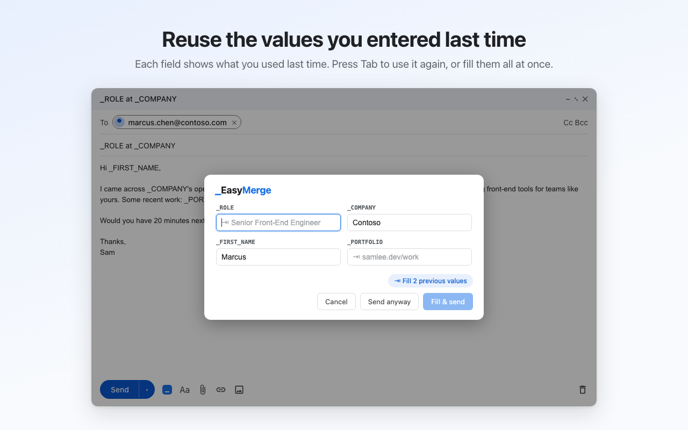

# EasyMerge

**Mail merge without the spreadsheet.** Type wildcards like `_FIRST_NAME` and `_COMPANY` into any Gmail draft.
When you hit Send, EasyMerge asks for each value, fills them in, and sends.

**[Install from the Chrome Web Store](https://chromewebstore.google.com/detail/easymerge/ilfcbigjmhigfeaalooblahkofjlbohf)**



## Why

Sending the same email to a lot of people one at a time (outreach, follow-ups, job applications) usually means
one of two things: a mail-merge tool that wants a spreadsheet and a campaign, or copy-paste-and-edit by hand. The
second one is how you end up sending "Hi NAME" to a hiring manager.

EasyMerge keeps you in the Gmail composer you already use, and makes that mistake impossible: an email with an
unfilled wildcard can't go out unless you say so.

## What it does

- **Your draft is the template.** Anything in `_ALL_CAPS` starting with an underscore is a wildcard. No setup, no
  template editor.
- **Send catches it.** EasyMerge intercepts Gmail's Send button, finds the wildcards in the subject and body, and opens a
  dialog with one field per wildcard.
- **Autofills what it can.** First name, last name, full name, and company come from the recipient (display name,
  or the address itself; free-mail domains like gmail.com are ignored for company).
- **Several recipients, one email each.** With two or more `To` recipients, the dialog becomes a table with a row per
  recipient, and each one gets their own email with their own values.
- **Remembers what you used.** Your last value for each wildcard shows as ghost text. Tab accepts it; "Fill N previous
  values" accepts them all.
- **One click to send the next one.** The compose-toolbar button reinserts your last EasyMerge email with its wildcards
  unfilled, ready for the next recipient.
- **Private by design.** No server, no account. Everything runs in your Gmail tab; the only thing stored is your last
  template, in `chrome.storage.local`.

<p>
  
  
</p>

## How it's built

- **Chrome MV3** extension, **TypeScript** + **Preact**, bundled with **Vite** and **CRXJS**.
- **[InboxSDK](https://www.inboxsdk.com/)** for the Gmail integration (Send interception, compose toolbar button), so
  it doesn't depend on scraping Gmail's DOM.
- Core logic (wildcard parsing, autofill, template memory, the send guard) lives in `src/lib/` as plain functions with
  **Vitest** tests; the Gmail and UI wiring is a thin layer on top.
- Chrome Web Store screenshots are rendered from the **real dialog component** with real autofill
  (`store/assets-src/`), not mocked up by hand.

```
src/
  background/   service worker (InboxSDK page-world loader)
  content/      Gmail integration entry point
  lib/          wildcards, autofill, guard, template memory, apply, merge (tested)
  ui/           Preact dialog and popover
store/          Web Store listing, privacy policy, release steps, screenshot renderer
```

## Build from source

```bash
npm install
cp .env.example .env   # set VITE_INBOXSDK_APP_ID (free at inboxsdk.com)
npm run dev            # or: npm run build, then load dist/ at chrome://extensions
npm test
```

Without an app ID, `npm run dev` loads but InboxSDK won't initialize, and `npm run build` refuses to run.

### Details

- Wildcard syntax: `_ALLCAPS` (min 2 chars, inner underscores OK). Double-click selects the whole token.
- Name/company aliases (which wildcard names autofill) live in `src/lib/autofill.ts`.
- Last-used values are remembered for the Gmail tab only.
- "Send anyway" skips the check for that compose window; closing the dialog does not.

### Several recipients

- Two or more `To` recipients turn the dialog into a table: one row per recipient, one column per
  wildcard, each row autofilled from its own recipient. "↓ all" copies a column's value to the empty
  cells (not offered for names and companies). × drops a recipient.
- Send opens a new Gmail compose window per row, fills it, and sends it, one after another, hidden
  behind the dialog. The last recipient's copy is sent from the original draft itself, once everyone
  else's has gone out.
- Cc and Bcc go on every email, and the From address (send-as alias) is kept.
- Stop, or a failure, ends the run. The draft stays open, addressed to whoever didn't get it yet, and
  Send picks up where it left off with the values you typed.
- "Send anyway" asks first, then sends the original single email to everyone, wildcards unfilled.
- Not split: replies and forwards (threading, forwarded attachments). They fill in place as before.
- Attachments go on every email: the draft's files are downloaded and uploaded again to each copy
  before it's sent. Inline images aren't copied yet.
- Gmail's daily sending limits apply (about 500 recipients a day for personal accounts).

## Publishing

`npm run release` typechecks, tests, builds, and zips `release/easymerge-<version>.zip` for the Chrome Web Store. See
[store/RELEASING.md](store/RELEASING.md) for the steps, [store/LISTING.md](store/LISTING.md) for the dashboard text,
and [store/PRIVACY.md](store/PRIVACY.md) for the privacy policy.

See [FUTURE.md](FUTURE.md) for what's next (list merge, smarter wildcard detection).
